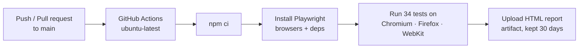

<h1 align="center">🧪 Singlish → Sinhala Translator: E2E Test Suite</h1>

<p align="center">
  Automated end-to-end tests for a live Singlish-to-Sinhala transliteration web app,
  running on <b>Chromium, Firefox and WebKit</b> with <b>CI on every push</b>.
</p>

<p align="center">
  
  
  
  
</p>

<!-- TODO: screenshot `npx playwright show-report`, save as docs/report.png, then uncomment:

-->

---

## ✨ What it tests

The target is [SwiftTranslator](https://swifttranslator.com/), which converts Romanised Sinhala ("Singlish") into Sinhala script as you type. Each test types a sentence into the app and asserts the expected Sinhala output appears.

| Type | Count | Examples |
|---|---|---|
| ✅ Positive functional (`Pos_Fun_*`) | 24 | tenses, questions, commands, English tech terms, dates, currency, emails, multi-line input |
| ❌ Negative functional (`Neg_Fun_*`) | 9 | joined words, chat short forms, ambiguous letters (t/th, retroflex n), very long words |
| 🖥️ Negative UI (`Neg_UI_*`) | 1 | URL typed into the input |
| **Total** | **34** | × 3 browsers = **102 test runs** |

Test design (inputs, expected and actual results) is documented in `IT23685116.xlsx`.

---

## ⚙️ CI pipeline



- On CI, failing tests are **retried twice** and run with a single worker to reduce flakiness against a live site.
- The HTML report is uploaded even when tests fail, so failures can be inspected from the Actions tab.

---

## 🚀 Run it locally

**Prerequisite:** Node.js 18+

```bash
git clone https://github.com/Gagana0819/ITPM-assignment-1-IT23685116-.git
cd ITPM-assignment-1-IT23685116-
npm ci
npx playwright install
npx playwright test                 # all browsers
npx playwright test --project=chromium --headed   # watch it run
npx playwright show-report
```

---

## 🧰 Tech stack

Playwright Test · TypeScript · Node.js · GitHub Actions

---

## 💡 What I learned & what I'd improve

**Learned**
- Testing a live third-party site means dealing with network delays, so explicit timeouts and CI retries matter.
- Writing negative cases forced me to think about how users actually break input, not just the happy path.

**Next improvements**
- [ ] Move test data into a JSON file and generate tests from it (data-driven) instead of repeating code
- [ ] Use the Page Object Model so selectors live in one place
- [ ] Replace `type()` with `pressSequentially()` (the newer Playwright API)
- [ ] Publish the HTML report to GitHub Pages from the workflow

---

<sub>Built for IT3040 IT Project Management (SLIIT).</sub>
